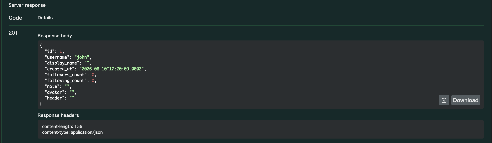
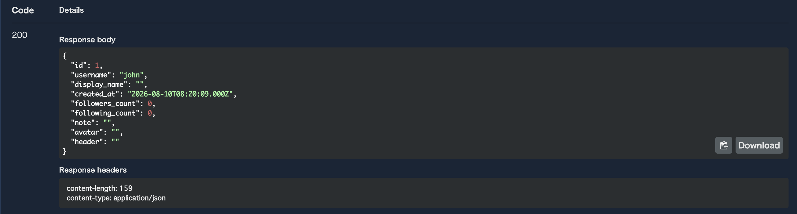
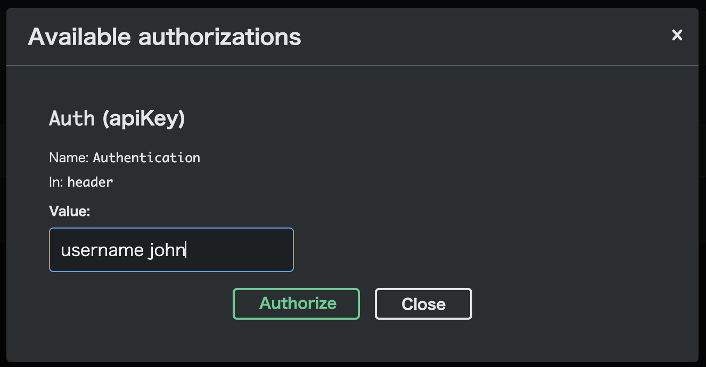
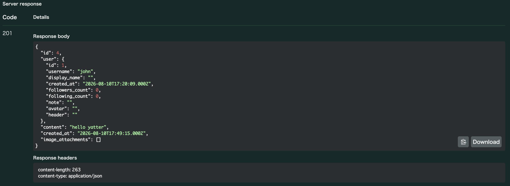

# 環境構築・起動確認

このプロジェクトを動かすための手順です。

## 前提

- Node.js がインストールされていること
- Docker がインストールされていること
- ターミナルでこのフロントエンドリポジトリのルートディレクトリにいること
- **バックエンドリファレンス（zip）を取得済み**で、展開できること

フロントエンド単体では API を呼べないため、先にローカルでバックエンドを起動します。

## 手順

### 1. バックエンドを起動する

> 起動コマンドや依存ツール（Docker / Go など）の詳細は、バックエンド側の README を正としてください。

#### zip を展開する

配布されたバックエンドの zip を展開し、そのディレクトリに移動します。

#### サーバーを起動する

1. サーバーを起動する

```bash
docker compose up --build -d
```

2. MySQL の起動を少し待ってから、テーブルを作成する

```bash
make migrate-up
```

#### ヘルスチェック

ブラウザで `http://localhost:8080/v1/health` を開きます。

「OK」が表示されていれば、サーバーは起動しています。

#### Swagger で初期データを作る

ブラウザで `http://localhost:8081` を開き、Swagger UI からユーザーと Yweet の初期データを作成します。

##### ユーザーを作成する（`POST /users`）

1. `POST /users` のアコーディオンを開く
2. `Try it out` をクリックする
3. リクエストボディに、次の JSON をコピペする

```json
{
  "username": "john",
  "password": "P@ssw0rd"
}
```

4. `Execute` を押して作成する
5. `Server Response` で **201** が返ってくることを確認する



##### ユーザーを確認する（`GET /users/{username}`）

1. `GET /users/{username}` のアコーディオンを開く
2. `Try it out` をクリックする
3. `username` に `john` を入力する
4. `Execute` を押し、ユーザーが作成されていることを確認する



##### Yweet を作成する（`POST /yweets`）

1. 画面上の 🔐 マークをクリックし、Auth 情報を設定する
2. `value` には `username john` を入れる（`john` だけでは通らない）



3. `POST /yweets` のアコーディオンを開く
4. `Try it out` をクリックする
5. リクエストボディは、最初から入っている例を消して、次の JSON に置き換える  
   （Swagger が最初から入れる `images` / `image_id` は存在しない ID のため、残すとエラーになる）

```json
{
  "yweet": "hello yatter"
}
```

6. `Execute` を押して Yweet を作成する



##### Yweet を確認する（`GET /yweets/{id}`）

1. `GET /yweets/{id}` のアコーディオンを開く
2. `Try it out` をクリックする
3. `id` に、作成した Yweet の id を入力する
4. `Execute` を押し、作成できていることを確認する

### 2. API のベース URL を `.env` に登録する

このフロントエンドリポジトリのルートに `.env` を作成し、次を書いてください。

```env
NEXT_PUBLIC_API_BASE_URL=http://localhost:8080
```

サンプルとして `.env.example` も置いてあります。コピーして使っても構いません。

```bash
cp .env.example .env
```

> `.env` は Git 管理対象外です。値を変えたあとは、開発サーバーを再起動してください。

### 3. 依存パッケージのインストール

```bash
npm install
```

`package.json` に書かれているパッケージが `node_modules` にインストールされます。

### 4. 開発サーバーの起動

```bash
npm run dev
```

起動に成功すると、ターミナルにローカル URL（例: `http://localhost:3000`）が表示されます。

### 5. 動作確認

ブラウザで表示された URL を開き、ページが表示されることを確認してください。
ファイルを編集して保存すると、ブラウザ側も自動で更新されます。

## よくあるつまずき

- フロントは起動しているが API だけ失敗する → バックエンドが `8080` で動いているか、`.env` の URL を確認する
- `.env` を直したのに反映されない → `npm run dev` を一度止めて再起動する
- `POST /yweets` が 401 になる → Auth の `value` が `username john` になっているか確認する（`john` だけでは通らない）
- `POST /yweets` が 500 になる → リクエストボディに `images` が残っている。Swagger が最初から入れる `image_id` は存在しない ID なので、上記のコピペ用 JSON に置き換える
