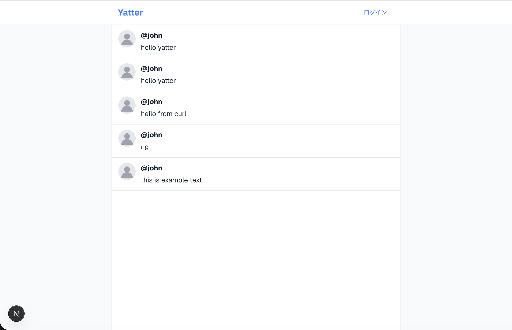

# タイムライン：RSC での fetch と表示

## このステップで学ぶこと

- React Server Component (RSC) でデータを取得する
- 取得した Yweet 一覧を画面に表示する
- 用意済みの `YweetCard` に props を渡して並べる

## 完成イメージ



## 作る／触るファイル（想定）

| ファイル | 役割 |
| --- | --- |
| `src/app/page.tsx` | タイムライン（ホーム）を RSC で実装 |
| `src/components/YweetCard.tsx` | 見た目は用意済み。props を渡して使う |
| `src/components/Timeline.tsx` | 一覧の枠レイアウト（用意済み） |

## 使う API（想定）

| メソッド | パス | 用途 |
| --- | --- | --- |
| `GET` | `/v1/timelines/public` | 公開タイムライン（Yweet 一覧）の取得 |

## 手順（アウトライン）

### 1. API のレスポンス形を確認する

まずは Swagger UI（`http://localhost:8081`）で `GET /v1/timelines/public` を開き、`Try it out` → `Execute` で実際のレスポンスを確認してください。

この API は **配列** で返ってきます（`{ "yweets": [...] }` のようなラッパーはありません）。

表示に使う主なフィールドは次のとおりです。

- `id` … 一覧の `key` に使える
- `user.username` … 投稿者名
- `content` … 本文

レスポンス例（1件だけ抜粋）:

```json
[
  {
    "id": 5,
    "user": {
      "id": 1,
      "username": "john",
      "display_name": "",
      "created_at": "2026-08-10T17:20:09.000Z",
      "followers_count": 0,
      "following_count": 0,
      "note": "",
      "avatar": "",
      "header": ""
    },
    "content": "hello yatter",
    "created_at": "2026-08-10T18:16:41.000Z",
    "image_attachments": []
  }
]
```

### 2. `page.tsx` で fetch する（RSC）

- `"use client"` は付けない
- `async` な Server Component から `fetch` する
- `json()` の結果は型が付かないので、型を自分で書いて `as` で付ける

```tsx
// src/app/page.tsx

type Yweet = {
  id: number;
  content: string;
  user: {
    username: string;
  };
};

// レスポンスは配列そのもの
type TimelineResponse = Yweet[];

const url = process.env.NEXT_PUBLIC_API_BASE_URL;

export default async function Home() {
  const data = await fetch(url + "/v1/timelines/public");

  // 確認する（ここは Response オブジェクト）
  console.log(data);

  const yweets = (await data.json()) as TimelineResponse;

  console.log(yweets);
  // ...
}
```

RSC 内の `console.log` はブラウザの DevTools ではなく、`npm run dev` を実行しているターミナルに出ます。

### 3. 取得結果を `YweetCard` で並べる

`YweetCard`（`src/components/YweetCard.tsx`） は、投稿者名・本文・アバターを受け取り、1件の投稿として表示するコンポーネントです。見た目（JSX）は用意してあるため、ここでは **どの props を渡すか** と **`map` で並べること** に集中します。

- `user.username` → `username`
- `content` → `content`
- （任意）`user.avatar` → `avatarUrl`（空ならデフォルトの SVG を表示）
- `key` には `yweet.id` を使う
- 削除ボタンはこのステップではまだ付けない（後のステップで追加）

```tsx
// src/app/page.tsx

type Yweet = {
  id: number;
  content: string;
  user: {
    username: string;
    avatar: string;
  };
};

type TimelineResponse = Yweet[];

const url = process.env.NEXT_PUBLIC_API_BASE_URL;

export default async function Home() {
  const data = await fetch(url + "/v1/timelines/public");

  // 確認する
  console.log(data);

  const yweets = (await data.json()) as TimelineResponse;

  console.log(yweets);

  return (
    <>
      {yweets.map((yweet) => (
        <YweetCard
          key={yweet.id}
          username={yweet.user.username}
          content={yweet.content}
          avatarUrl={yweet.user.avatar}
        />
      ))}
    </>
  );
}
```

### 4. 動作確認

- [ ] 開発サーバー上でタイムラインが表示される
- [ ] データが空のときの見え方も確認する
  - Dockerの永続データを初期化すると、Yweetしたデータを削除できます
  - 動作確認後は、ユーザー情報の再登録をお願いします