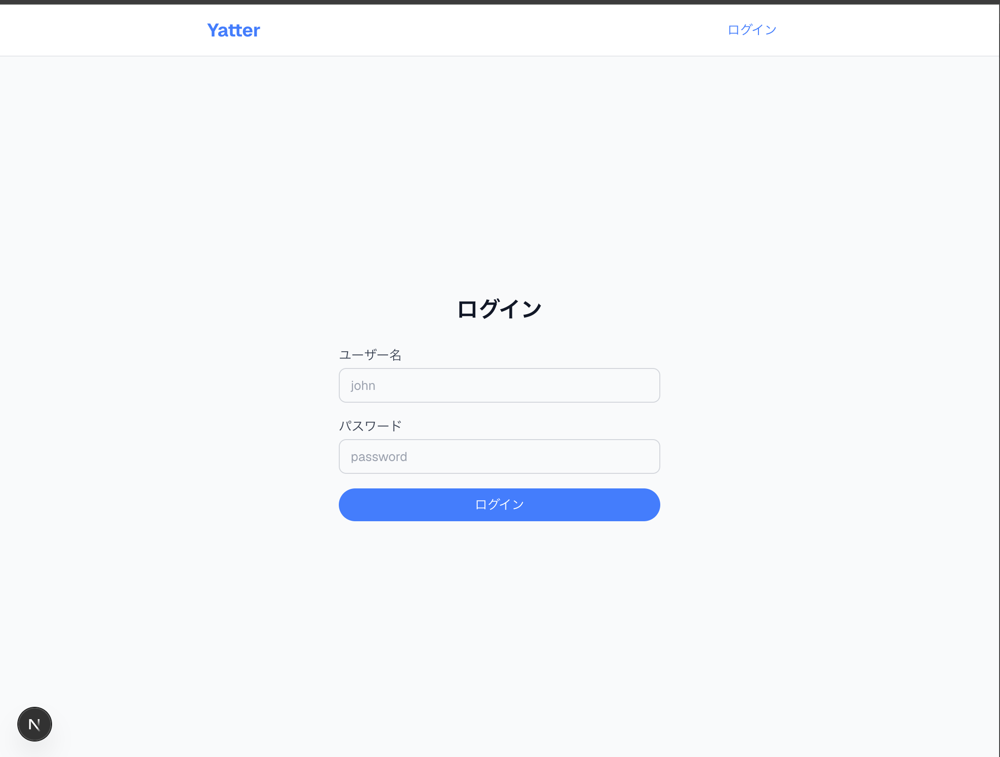

# ログイン：フォーム・API・Cookie・Context

## このステップで学ぶこと

- Client Component（`"use client"`）でのフォーム作成
- `useState` による入力値の管理
- ログイン API の呼び出し（用意済みの `useAuth().login` を使う）
- ログイン後の画面遷移（`router.push`）
- Context で共有されたログイン状態の使い方

## 完成イメージ



## 作る／触るファイル

| ファイル | 役割 | 誰が書くか |
| --- | --- | --- |
| `src/app/login/page.tsx` | ログインフォーム（`"use client"`） | **自分で作る** |
| `src/auth/AuthProvider.tsx` | Context / `useAuth`（`login`・`logout` など） | 用意済み |
| `src/lib/authCookie.ts` | Cookie の保存・削除 | 用意済み |
| `src/app/layout.tsx` | Cookie を読んで Provider に渡す | 用意済み |
| `src/components/HeaderNav.tsx` | ログイン状態に応じたヘッダー右側 | 用意済み |
| `src/components/Header.tsx` | ヘッダーの枠（見た目） | 用意済み |

## 使う API（想定）

| メソッド | パス | 用途 |
| --- | --- | --- |
| `POST` | `/v1/auth/login` | ログイン |

## 手順（アウトライン）

### 1. `/login` ページを作る

- App Router のファイル配置を確認する
- `src/app/login/page.tsx` を作成する
- `http://localhost:3000/login` で開けることを確認する（中身は次のステップで書く）

### 2. フォーム UI を組む

- 既存の `Input` / `Button` を使う
- 見た目は下の JSX を参考にする
- 入力値は自分で `useState` を足して管理する（`value` / `onChange`）

```tsx
// src/app/login/page.tsx

"use client";

import { Button } from "@/components/Button";
import { Input } from "@/components/Input";

export default function Page() {
  // username / password は useState で持つ

  return (
    <div className="mx-auto flex min-h-[calc(100vh-3.5rem)] max-w-sm flex-col justify-center px-4">
      <h1 className="mb-6 text-center text-2xl font-bold text-gray-900">
        ログイン
      </h1>
      <form
        className="flex flex-col gap-4"
        onSubmit={(e) => {
          e.preventDefault();
          // 送信処理は次のステップで書く
        }}
      >
        <label className="flex flex-col gap-1 text-sm text-gray-700">
          ユーザー名
          <Input
            type="text"
            name="username"
            placeholder="john"
            autoComplete="username"
          />
        </label>
        <label className="flex flex-col gap-1 text-sm text-gray-700">
          パスワード
          <Input
            type="password"
            name="password"
            placeholder="password"
            autoComplete="current-password"
          />
        </label>
        <Button type="submit" className="w-full">
          ログイン
        </Button>
      </form>
    </div>
  );
}
```

### 3. ログイン API を叩く

まずは Swagger UI（`http://localhost:8081`）で `POST /auth/login`（実 URL は `/v1/auth/login`）を確認してください。

リクエストボディ:

```json
{
  "username": "john",
  "password": "P@ssw0rd"
}
```

成功時（200）のレスポンス例:

```json
{
  "username": "john"
}
```

失敗時は `400` などが返ります。トークンはレスポンスに含まれません。後続の認証付き API では、Setup と同様にヘッダ `Authentication: username john` の形を使います（保存の詳細は次のステップ）。

フォームの `onSubmit` に渡すハンドラのイメージ:

```tsx
// src/app/login/page.tsx

const handleSubmit = async (e: React.FormEvent<HTMLFormElement>) => {
  e.preventDefault(); // ページリロードを防ぐ

  // 空チェックなどはここで

  const res = await fetch(
    `${process.env.NEXT_PUBLIC_API_BASE_URL}/v1/auth/login`,
    {
      method: "POST",
      headers: {
        "Content-Type": "application/json",
      },
      body: JSON.stringify({
        username,
        password,
      }),
    }
  );

  if (!res.ok) {
    // エラー表示など
    return;
  }

  const data = (await res.json()) as { username: string };
  console.log(data);
  // Cookie 保存・遷移は次のステップ以降
};
```

フォーム側は次のように繋ぐ:

```tsx
// src/app/login/page.tsx

<form className="flex flex-col gap-4" onSubmit={handleSubmit}>
```

- Client Component から呼ぶので、ブラウザの DevTools（Network / Console）でも確認できる
- ユーザー名やパスワードが空のときは、API を叩く前に簡単なチェックを入れる


### 4. Cookie と Context（用意済みの `useAuth` を使う）

Cookie の保存や Context の更新は、**自分で書かなくてよい**です。用意済みの `useAuth().login` がまとめてやってくれます。

#### Cookie に何が入るか（参考）

| 項目 | 値 |
| --- | --- |
| キー | `yatter_username` |
| 値 | ログインしたユーザー名（例: `john`） |
| 有効期限 | 7日 |

トークンは使いません。あとで認証付き API を叩くときは、Cookie のユーザー名から `Authentication: username john` 形式のヘッダを作ります（`getAuthenticationHeader()`）。

#### 学生側でやること

1. `useAuth` から `login` を取り出す
2. ステップ 3 の `fetch` の代わりに `await login(username, password)` を呼ぶ
3. 成功したら `router.push("/")` でタイムラインへ戻る

```tsx
// src/app/login/page.tsx
"use client";

import { useRouter } from "next/navigation";
import { useAuth } from "@/auth/AuthProvider";
// Input / Button / useState は省略

export default function Page() {
  const { login } = useAuth();
  const router = useRouter();
  // username / password の useState ...

  const handleSubmit = async (e: React.FormEvent<HTMLFormElement>) => {
    e.preventDefault();

    // 空チェック ...

    try {
      await login(username, password);
      router.push("/");
    } catch {
      // エラー表示
    }
  };

  // return ... form onSubmit={handleSubmit}
}
```

`login` の中ではだいたい次が行われています（実装を読む用・変更は不要）。

1. `POST /v1/auth/login` を叩く
2. 成功したら Cookie（`yatter_username`）にユーザー名を保存する
3. Context の `user` を更新する → Header がログイン表示に切り替わる

`layout.tsx` では、リロード時に Cookie を読んで Provider の初期値に渡しています。そのためリロード後もログイン状態が維持されます。

### 5. 動作確認

- [ ] ログイン成功後にタイムラインへ戻れる
- [ ] リロード後もログイン状態が維持される（Cookie）