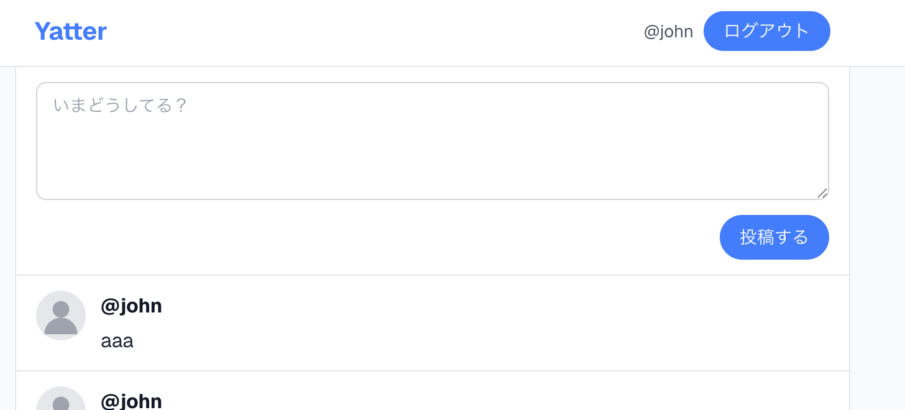

# Yweet 投稿：Client からの API 送信と画面更新

## このステップで学ぶこと

- RSC で取得したデータを Client Component に props で渡す
- 一覧を Client 側の `useState` で持ち、`map` で表示する
- Client Component から投稿 API を呼ぶ（`Authentication` ヘッダ）
- 投稿の成功レスポンスを state に追加して、再取得なしで画面を更新する

## 完成イメージ



## 作る／触るファイル

| ファイル | 役割 | 誰が書くか |
| --- | --- | --- |
| `src/types/yweet.ts` | `Yweet` 型（`page.tsx` から移動） | **学生が作る** |
| `src/components/TimelineFeed.tsx` | 一覧の state を持つ Client Component | **学生が作る** |
| `src/components/PostYweetForm.tsx` | 投稿フォーム（Client Component） | **学生が作る**（JSX はガイド参照） |
| `src/components/Textarea.tsx` | 複数行入力（見た目用） | 用意済み |
| `src/components/Timeline.tsx` | タイムライン全体の枠レイアウト | 用意済み |
| `src/app/page.tsx` | 取得した配列を渡すだけに書き換える | **学生が直す** |

## 使う API

| メソッド | パス | 用途 |
| --- | --- | --- |
| `POST` | `/v1/yweets` | Yweet の投稿 |

## 考え方

02 では `page.tsx`（RSC）で `fetch` して、そのまま `map` で並べました。  
投稿できるようにすると、**投稿した直後に一覧が増える**必要があります。RSC はサーバーで一度実行されるだけなので、表示中の配列を Client 側で書き換えられません。

そこで境界を1つ動かします。

- **取得は RSC のまま**（`page.tsx` で `fetch`）
- 取得した配列を **Client Component に props で渡す**
- Client 側で `useState` に入れて持ち、`map` で表示する
- 投稿が成功したら、返ってきた Yweet を **state に追加**する

投稿 API は成功時に作成された Yweet 本体を返してくれるので、**一覧の再取得は不要**です。

## 手順

### 1. `Yweet` 型を共通ファイルに移す

`page.tsx` と新しい Client Component の両方で使うので、型を切り出します。

- `src/types/yweet.ts` を作る
- 02 で `page.tsx` に書いた `Yweet` 型を移して `export` する
- `page.tsx` 側は `import type { Yweet } from "@/types/yweet";` に直す

新規: `src/types/yweet.ts`

```ts
// src/types/yweet.ts

export type Yweet = {
  id: number;
  content: string;
  user: {
    username: string;
    avatar: string;
  };
};
```

`page.tsx` の変更（diff）:

```diff
// src/app/page.tsx

+import type { Yweet } from "@/types/yweet";
+
-type Yweet = {
-  id: number;
-  content: string;
-  user: {
-    username: string;
-    avatar: string;
-  };
-};
-
-type TimelineResponse = Yweet[];
-
 export default async function Home() {
   // ...
-  const yweets = (await data.json()) as TimelineResponse;
+  const yweets = (await data.json()) as Yweet[];
```

### 2. 一覧を Client Component に移す

- `src/components/TimelineFeed.tsx` を作る（先頭に `"use client"`）
- 用意済みの `src/components/Timeline.tsx` を `page.tsx` で新しく使い、一覧全体を囲む
- props で `initialYweets: Yweet[]` を受け取る
- `useState` に `initialYweets` を初期値として入れる
- 02 で `page.tsx` に書いた `map` の部分を、ここに **移動**する
- 0件のときのメッセージも、投稿したら消えないといけないので一緒に移す

新規: `src/components/TimelineFeed.tsx`

```tsx
// src/components/TimelineFeed.tsx

"use client";

import { useState } from "react";
import { YweetCard } from "@/components/YweetCard";
import type { Yweet } from "@/types/yweet";

type TimelineFeedProps = {
  initialYweets: Yweet[];
};

export function TimelineFeed({ initialYweets }: TimelineFeedProps) {
  const [yweets, setYweets] = useState<Yweet[]>(initialYweets);

  // 投稿フォームはこのあと足す

  return (
    <>
      {yweets.length === 0 ? (
        <p className="px-4 py-8 text-center text-sm text-gray-500">
          まだ Yweet がありません
        </p>
      ) : (
        yweets.map((yweet) => (
          <YweetCard
            key={yweet.id}
            username={yweet.user.username}
            content={yweet.content}
            avatarUrl={yweet.user.avatar}
          />
        ))
      )}
    </>
  );
}
```

`page.tsx` の return 周辺（diff）:

```diff
// src/app/page.tsx

+import { Timeline } from "@/components/Timeline";
+import { TimelineFeed } from "@/components/TimelineFeed";
+
 export default async function Home() {
   // fetch はそのまま
   // ...

   return (
-    <>
-      {yweets.map((yweet) => (
-        <YweetCard
-          key={yweet.id}
-          username={yweet.user.username}
-          content={yweet.content}
-          avatarUrl={yweet.user.avatar}
-        />
-      ))}
-    </>
+    <Timeline>
+      <TimelineFeed initialYweets={yweets} />
+    </Timeline>
   );
 }
```

`YweetCard` の import は `TimelineFeed` 側に移したので、`page.tsx` からは消して大丈夫です。  
`fetch` 失敗時の表示はサーバー側（`page.tsx`）に残して構いません。

ここまでで、**見た目は 02 と同じまま**動くことを確認してください。

> `Timeline` は `<main>` の枠だけを持つ見た目コンポーネントなので、`"use client"` は付けません。state を持つのは `TimelineFeed` 側です。

### 3. 投稿フォーム UI を作る

- `src/components/PostYweetForm.tsx` を作る（`"use client"`）
- 見た目は下の JSX を参考にする
- 親から `onPosted` を受け取る（中身の呼び出しは手順 6）
- `TimelineFeed` の一覧より前に置く
- 入力の `useState` と送信処理は次のステップで足す

```tsx
// src/components/PostYweetForm.tsx

"use client";

import { Button } from "@/components/Button";
import { Textarea } from "@/components/Textarea";
import type { Yweet } from "@/types/yweet";

type PostYweetFormProps = {
  /** 投稿に成功したとき、作成された Yweet を親に渡す */
  onPosted: (yweet: Yweet) => void;
};

export function PostYweetForm({ onPosted }: PostYweetFormProps) {
  // 入力値は次のステップで useState で持つ
  // onPosted は送信成功後（手順 6）で呼ぶ

  return (
    <form
      className="flex flex-col gap-3 border-b border-gray-200 px-4 py-3"
      onSubmit={(e) => {
        e.preventDefault();
        // 送信処理はあとで書く
      }}
    >
      <Textarea name="yweet" placeholder="いまどうしてる？" />
      <div className="flex justify-end">
        <Button type="submit">投稿する</Button>
      </div>
    </form>
  );
}
```

用意済みの `Textarea`（`src/components/Textarea.tsx`）を使います。複数行なので `Input` ではなくこちらです。

表示は **ログイン中だけ** にします。`TimelineFeed` で `useAuth()` の `user` を受け取り、`return` の中で **Yweet 一覧より前** にフォームを置きます。

```tsx
// src/components/TimelineFeed.tsx

import { useAuth } from "@/auth/AuthProvider";
import { PostYweetForm } from "@/components/PostYweetForm";

export function TimelineFeed({ initialYweets }: TimelineFeedProps) {
  const { user } = useAuth();
  const isLoggedIn = !!user;
  const [yweets, setYweets] = useState<Yweet[]>(initialYweets);

  function handlePosted(created: Yweet) {
    // state への追加は手順 6 で実装する
  }

  return (
    <>
      {/* ログイン中だけ、一覧の上に投稿フォームを表示する */}
      {isLoggedIn && <PostYweetForm onPosted={handlePosted} />}

      {yweets.length === 0 ? (
        <p className="px-4 py-8 text-center text-sm text-gray-500">
          まだ Yweet がありません
        </p>
      ) : (
        yweets.map((yweet) => (
          <YweetCard
            key={yweet.id}
            username={yweet.user.username}
            content={yweet.content}
            avatarUrl={yweet.user.avatar}
          />
        ))
      )}
    </>
  );
}
```

### 4. `useState` で入力を持つ

ログインと同じです。自分で足してください。

- `useState` で本文（例: `content`）を持つ
- `Textarea` に `value` / `onChange` を渡す
- 空文字のときは送信しない、などの簡単なチェックを入れる
- エラーメッセージ用の state（例: `error`）も持っておくと親切です
- 連打防止用に `isSubmitting` も持つ（送信中はボタンを `disabled` にする）

```tsx
// src/components/PostYweetForm.tsx

const [content, setContent] = useState("");
const [error, setError] = useState("");
const [isSubmitting, setIsSubmitting] = useState(false);
```

`Textarea` / `Button` への繋ぎ方:

```tsx
// src/components/PostYweetForm.tsx

<Textarea
  name="yweet"
  placeholder="いまどうしてる？"
  value={content}
  onChange={(e) => setContent(e.target.value)}
/>
{error && <p className="text-sm text-red-500">{error}</p>}
<div className="flex justify-end">
  <Button type="submit" disabled={isSubmitting}>
    投稿する
  </Button>
</div>
```

### 5. 投稿 API を叩く

まずは Swagger UI（`http://localhost:8081`）で `POST /yweets`（実 URL は `/v1/yweets`）を確認してください。🔐 で Auth（`username john`）を設定してから試せます。

| 項目 | 内容 |
| --- | --- |
| メソッド / パス | `POST /v1/yweets` |
| 認証 | ヘッダ `Authentication: username john` |
| body | `{ "yweet": "本文" }`（`images` は入れない） |
| 成功 | `201` + 作成された Yweet |

認証ヘッダは、用意済みの `useAuth().getAuthenticationHeader()` で取れます。

成功時のレスポンスは、タイムライン取得と同じ形の Yweet が1件で返ってきます。**これをそのまま一覧に足せます。**

```json
{
  "id": 8,
  "user": {
    "id": 1,
    "username": "john",
    "display_name": "",
    "created_at": "2026-08-10T17:20:09.000Z",
    "followers_count": 0,
    "following_count": 0,
    "note": "",
    "avatar": "",
    "header": ""
  },
  "content": "hello yatter",
  "created_at": "2026-08-18T19:20:36.000Z",
  "image_attachments": []
}
```

フォームの `onSubmit` に渡すハンドラのイメージ:

```tsx
// src/components/PostYweetForm.tsx

const { getAuthenticationHeader } = useAuth();

const handleSubmit = async (e: React.FormEvent<HTMLFormElement>) => {
  e.preventDefault(); // ページリロードを防ぐ

  if (content.trim() === "") {
    setError("本文を入力してください");
    return;
  }

  const authentication = getAuthenticationHeader();
  if (!authentication) {
    setError("投稿するにはログインが必要です");
    return;
  }

  setError("");
  setIsSubmitting(true);

  try {
    const res = await fetch(
      `${process.env.NEXT_PUBLIC_API_BASE_URL}/v1/yweets`,
      {
        method: "POST",
        headers: {
          "Content-Type": "application/json",
          Authentication: authentication,
        },
        body: JSON.stringify({
          yweet: content,
        }),
      }
    );

    if (!res.ok) {
      setError("投稿に失敗しました");
      return;
    }

    const created = (await res.json()) as Yweet;
    // created を一覧に足す（次のステップ）
  } finally {
    // 成功・失敗どちらでも送信中フラグを戻す
    setIsSubmitting(false);
  }
};
```

フォーム側は次のように繋ぎます:

```tsx
// src/components/PostYweetForm.tsx

<form
  className="flex flex-col gap-3 border-b border-gray-200 px-4 py-3"
  onSubmit={handleSubmit}
>
```

### 6. 成功後に一覧へ追加する

一覧の state は `TimelineFeed` が持っていて、投稿の成功を知るのは `PostYweetForm` です。  
手順 3 で渡した `onPosted` を、送信成功時に呼びます。

`TimelineFeed` 側（`handlePosted` の中身）:

```tsx
// src/components/TimelineFeed.tsx

function handlePosted(created: Yweet) {
  setYweets((prev) => [created, ...prev]);
}
```

`PostYweetForm` 側（`handleSubmit` の成功時）:

```tsx
// src/components/PostYweetForm.tsx

const created = (await res.json()) as Yweet;
onPosted(created);
setContent("");
```

- props の型 `onPosted: (yweet: Yweet) => void` は手順 3 で定義済み
- 送信成功後に `onPosted(created)` を呼ぶ
- あわせて入力欄を空に戻す（`setContent("")`）

新しい Yweet を先頭に入れているので、タイムラインの一番上に増えます。

### 7. 動作確認

- [ ] ログイン中だけ投稿フォームが出る
- [ ] 投稿するとリクエストなしで一覧の先頭に増える
- [ ] 投稿後に入力欄が空になる
- [ ] 送信中はボタンが押せない（連打しても二重投稿しない）
- [ ] リロードしても投稿が残っている（サーバーに保存できている）

## 補足：`router.refresh()` という手もある

state に足す代わりに、`useRouter().refresh()` を呼んで **RSC（`page.tsx`）を再実行させる**方法もあります。

```tsx
// src/components/PostYweetForm.tsx

import { useRouter } from "next/navigation";

const router = useRouter();
// 成功時
router.refresh();
```

- state 追加… リクエスト0回で速い。ただし他の人の投稿は増えない
- `router.refresh()`… サーバーから取り直すので最新になる。ただし通信が1回増える

今回は前者で作りますが、削除（07）などで再取得したくなったときに思い出してください。
