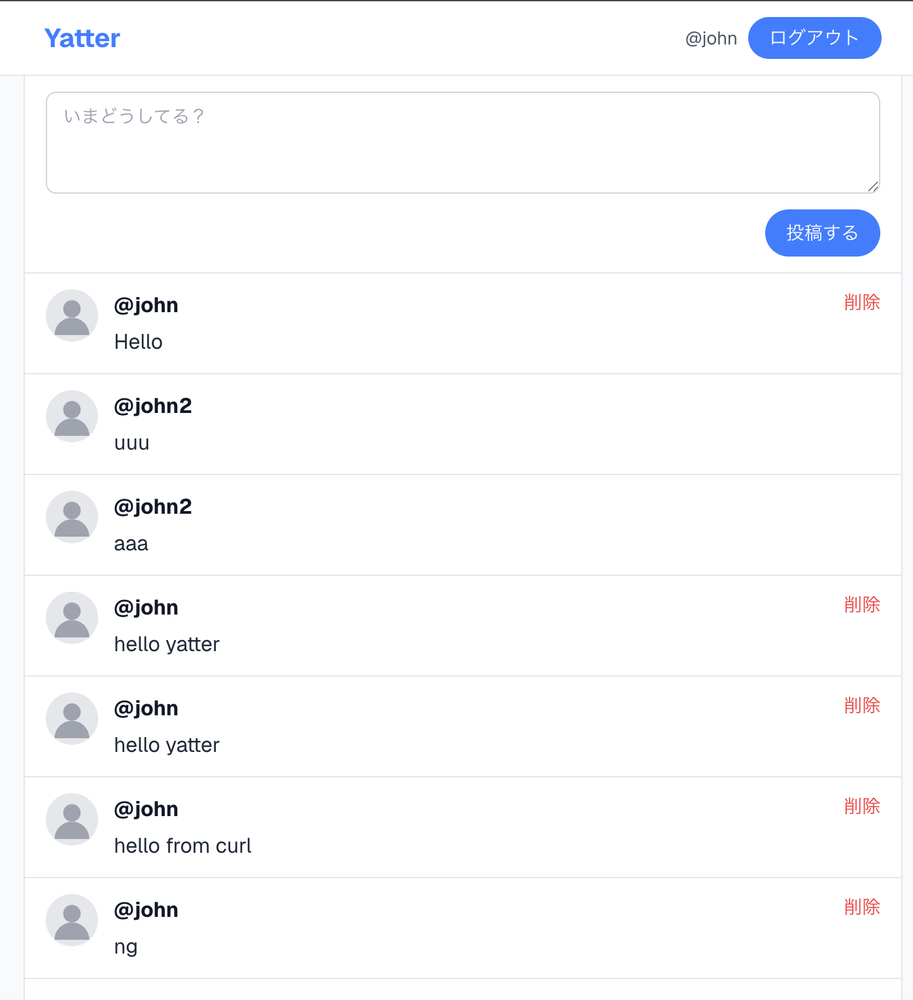
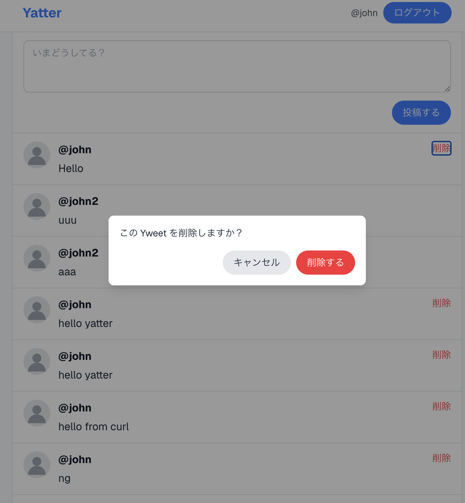
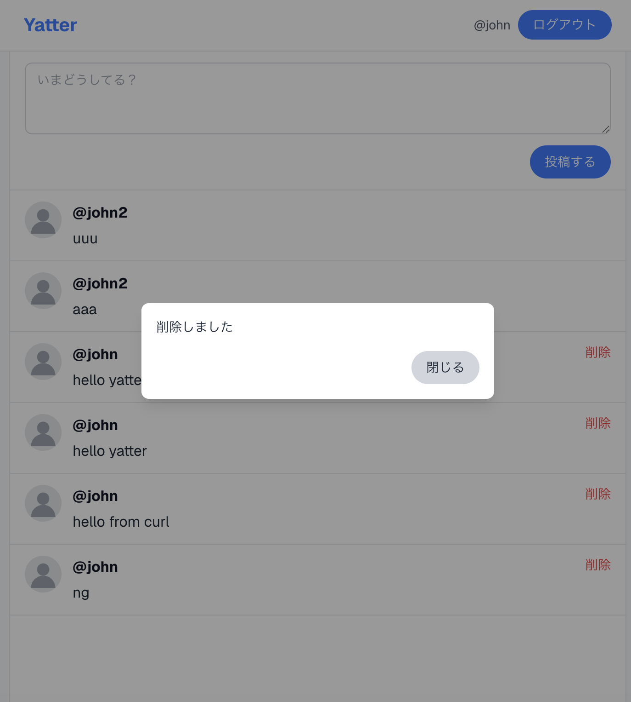

# Yweet 削除：削除 API と画面更新

04 の投稿と同じく、一覧の state は `TimelineFeed` が持っています。削除も再取得せず、成功したら配列から除きます。

## このステップで学ぶこと

- `YweetCard` に削除ボタンを足し、処理は props で親に渡す
- Confirm の `isOpen` は **一覧側（`TimelineFeed`）** で持つ
- カードを消してもダイアログは残るので、「削除しました」を出せる
- 自分の投稿だけ削除できるようにする

## 完成イメージ

削除ボタン



削除確認



削除完了



## 作る／触るファイル

| ファイル | 役割 | 誰が書くか |
| --- | --- | --- |
| `src/components/ConfirmDialog.tsx` | 確認ダイアログ（見た目）。`isOpen` などで開閉 | **学生が作る**（JSX はガイド参照） |
| `src/components/YweetCard.tsx` | 削除ボタン。`onDelete` があるときだけ出す | **学生が直す** |
| `src/components/TimelineFeed.tsx` | `isOpen` / 対象 id / API / 完了表示 | **学生が直す** |

カードの中に Confirm を置くと、削除成功でカードが消えた瞬間にダイアログも消えます。一覧の外（Feed）で1つ持てば、行を消したあとも「削除しました」を出せます。

## 使う API

| メソッド | パス | 用途 |
| --- | --- | --- |
| `DELETE` | `/v1/yweets/{id}` | 指定 Yweet の削除 |

Swagger UI（`http://localhost:8081`）で `DELETE /yweets/{id}` を確認してください。🔐 で Auth（`username john`）が必要です。成功は `200` です。

## 満たす条件

- [ ] 自分の Yweet にだけ削除ボタンが出る
- [ ] 押すと確認ダイアログが出る。キャンセル（ボタンまたはオーバーレイ）なら消えない
- [ ] OK なら一覧から消え、ダイアログが「削除しました」になる。閉じるまでダイアログは残る

## 手順

### 1. Confirm の見た目を作る

- `src/components/ConfirmDialog.tsx` を作る（`"use client"` は付けなくてよい。state は親が持つ）
- `isOpen` が `false` のときは何も出さない
- OK / キャンセルは props の関数を呼ぶだけ（API は書かない）
- 背景（オーバーレイ）をクリックしたときも、キャンセルと同じ `onCancel` を呼ぶ
- 白いパネル側のクリックは `stopPropagation` しないと、親のオーバーレイまで届いて閉じてしまう

```tsx
// src/components/ConfirmDialog.tsx

import { Button } from "@/components/Button";

type ConfirmDialogProps = {
  isOpen: boolean;
  message: string;
  onConfirm?: () => void;
  onCancel: () => void;
  confirmLabel?: string;
  cancelLabel?: string;
  /** false のときは閉じるボタンだけ出す（削除完了後） */
  showConfirm?: boolean;
};

export function ConfirmDialog({
  isOpen,
  message,
  onConfirm,
  onCancel,
  confirmLabel = "削除する",
  cancelLabel = "キャンセル",
  showConfirm = true,
}: ConfirmDialogProps) {
  if (!isOpen) return null;

  return (
    <div
      className="fixed inset-0 z-50 flex items-center justify-center bg-black/40 px-4"
      onClick={onCancel}
    >
      <div
        className="w-full max-w-sm rounded-lg bg-white p-4 shadow-lg"
        onClick={(e) => e.stopPropagation()}
      >
        <p className="text-sm text-gray-800">{message}</p>
        <div className="mt-4 flex justify-end gap-2">
          <Button
            type="button"
            className="bg-gray-200 !text-gray-800 hover:bg-gray-300"
            onClick={onCancel}
          >
            {cancelLabel}
          </Button>
          {showConfirm && (
            <Button
              type="button"
              className="bg-red-500 hover:bg-red-600"
              onClick={onConfirm}
            >
              {confirmLabel}
            </Button>
          )}
        </div>
      </div>
    </div>
  );
}
```

### 2. `YweetCard` に削除ボタンを足す

- `onDelete?` を props で受け取る。**無いときはボタンを出さない**
- ボタンは `onClick={onDelete}` だけ。Confirm も `useState` もカードには書かない
- `"use client"` は不要（state を持たないため）

```tsx
// src/components/YweetCard.tsx

type YweetCardProps = {
  username: string;
  content: string;
  avatarUrl?: string;
  onDelete?: () => void;
};

// ユーザー名の横
<div className="flex items-start justify-between gap-2">
  <p className="font-bold text-gray-900">@{username}</p>
  {onDelete && (
    <button
      type="button"
      className="shrink-0 text-sm text-red-500 hover:text-red-600"
      onClick={onDelete}
    >
      削除
    </button>
  )}
</div>
```

ここまでだと親が `onDelete` を渡していないので、ボタンはまだ出ません。

### 3. `TimelineFeed` で Confirm と API を持つ

Confirm は **map の外** に1つだけ置きます。

#### 3-1. 開閉の state をログで確認する

- `deletingId`（今消そうとしている id。無ければ `null`）
- `isOpen` は `deletingId !== null`
- 自分の投稿だけ `onDelete={() => handleDeleteClick(yweet.id)}`
- いまは API を叩かず、`console.log` する

```tsx
// src/components/TimelineFeed.tsx

const [deletingId, setDeletingId] = useState<number | null>(null);
const isOpen = deletingId !== null;
console.log("isOpen", isOpen, "deletingId", deletingId);

function handleDeleteClick(id: number) {
  setDeletingId(id);
}

function handleCancel() {
  setDeletingId(null);
}

// map の中
const isOwn = user?.username === yweet.user.username;

<YweetCard
  key={yweet.id}
  username={yweet.user.username}
  content={yweet.content}
  avatarUrl={yweet.user.avatar}
  onDelete={isOwn ? () => handleDeleteClick(yweet.id) : undefined}
/>
```

自分の投稿の「削除」を押して、DevTools で `isOpen` が `true` になることを確認してください。

#### 3-2. Confirm をつなぐ

```tsx
// src/components/TimelineFeed.tsx

function handleCancel() {
  setDeletingId(null);
  setIsDone(false);
}

<ConfirmDialog
  isOpen={isOpen}
  message="この Yweet を削除しますか？"
  onConfirm={handleConfirm}
  onCancel={handleCancel}
/>
```

`handleConfirm` は次のステップで実装します。仮で `function handleConfirm() {}` と置いて、キャンセルとオーバーレイで閉じることだけ先に確認してもよいです。

#### 3-3. 削除 API と完了表示

- `isDone` を足す
- OK で `DELETE /v1/yweets/{id}` を叩く
- 成功したら **先に一覧から除く**。Confirm は Feed にあるので残る
- `isDone` を `true` にして「削除しました」+「閉じる」にする
- 04 で書いてある `const { user } = useAuth();` に `getAuthenticationHeader` を足す（`user` は自分の投稿判定で既に使っている）

```tsx
// src/components/TimelineFeed.tsx

const { user, getAuthenticationHeader } = useAuth();
const [isDone, setIsDone] = useState(false);

function handleDeleteClick(id: number) {
  setIsDone(false);
  setDeletingId(id);
}

async function handleConfirm() {
  if (deletingId === null) return;

  const authentication = getAuthenticationHeader();
  if (!authentication) {
    setDeletingId(null);
    return;
  }

  try {
    const res = await fetch(
      `${process.env.NEXT_PUBLIC_API_BASE_URL}/v1/yweets/${deletingId}`,
      {
        method: "DELETE",
        headers: {
          Authentication: authentication,
        },
      }
    );

    if (!res.ok) {
      throw new Error("削除に失敗しました");
    }

    setYweets((prev) => prev.filter((yweet) => yweet.id !== deletingId));
    setIsDone(true);
  } catch {
    setDeletingId(null);
    setIsDone(false);
  }
}

<ConfirmDialog
  isOpen={isOpen}
  message={isDone ? "削除しました" : "この Yweet を削除しますか？"}
  showConfirm={!isDone}
  cancelLabel={isDone ? "閉じる" : "キャンセル"}
  onConfirm={handleConfirm}
  onCancel={handleCancel}
/>
```

### 4. 動作確認

- [ ] 自分の Yweet にだけ「削除」が出る
- [ ] キャンセル、またはオーバーレイクリックでダイアログが閉じ、投稿は残る
- [ ] OK すると一覧から消え、ダイアログが「削除しました」になる
- [ ] 「閉じる」でダイアログが消え、リロードしても投稿は戻ってこない
