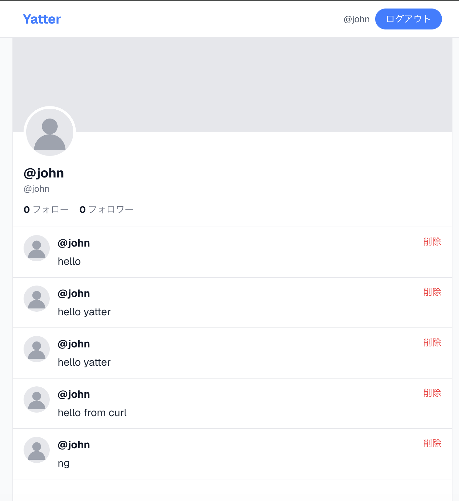

# プロフィールページ：動的ルーティング

URL の一部がユーザーごとに変わるページを、App Router のフォルダ名で作ります。  
ユーザー情報のあとに、その人の Yweet 一覧を足します。フォロー／解除の API は 09 です。

## このステップで学ぶこと

- 動的ルーティング（`src/app/users/[username]/page.tsx`）
- `params` を RSC で受け取って `fetch` する
- 2つの `fetch` を直列で書いて表示する（`Promise.all` と関数分けは任意）
- タイムラインの `@username` からプロフィールへ `Link` する
- 一覧の削除は RSC ではできないので、`ProfileFeed`（Client）に移す
- `useAuth` で、他人のプロフィールにだけ「フォロー」ボタンを出す（押したあとは 09）

## 完成イメージ

`/users/john` を開くと、そのユーザーのプロフィール（ヘッダー・アイコン・名前・自己紹介・フォロー数）と、その人の Yweet が出る。  
タイムラインの `@username` からプロフィールに入れる。自分の投稿には削除が出る。ログイン中に他人のページを開くと「フォロー」が出る（自分のページと未ログインでは出ない）。



## 作る／触るファイル

| ファイル | 役割 | 誰が書くか |
| --- | --- | --- |
| `src/app/users/[username]/page.tsx` | プロフィール（RSC） | **学生が作る** |
| `src/components/ProfileFeed.tsx` | その人の Yweet 一覧と削除（Client） | **学生が作る** |
| `src/components/YweetCard.tsx` | `@username` をプロフィールへの `Link` にする | **学生が直す** |
| `src/components/ProfileActionButton.tsx` | 他人なら「フォロー」を出す（Client） | **学生が作る** |

フォルダ名は `[id]` ではなく **`[username]`** にします。API がユーザー名で取るためです（`GET /v1/users/1` は 404 になる）。

## 使う API

| メソッド | パス | 用途 |
| --- | --- | --- |
| `GET` | `/v1/users/{username}` | ユーザー情報 |
| `GET` | `/v1/users/{username}/yweets` | そのユーザーの Yweet 一覧 |

Swagger UI で `GET /users/{username}` を試してください。成功時（200）の例:

```json
{
  "id": 1,
  "username": "john",
  "display_name": "",
  "created_at": "2026-08-10T08:20:09.000Z",
  "followers_count": 0,
  "following_count": 0,
  "note": "",
  "avatar": "",
  "header": ""
}
```

存在しないユーザーは `404` です。  
`followers_count` / `following_count` は実際の件数です（誰もフォローしていなければ `0`）。

## 手順

### 1. ページファイルを作る

- `src/app/users/[username]/page.tsx` を作る
- `http://localhost:3000/users/john` で開けることを確認する（中身は次）

`[username]` のフォルダ名が、URL のその部分になります。

### 2. `params` を受け取って fetch する

このプロジェクトの Next.js では、`params` は **Promise** です。`await` してから使います。

タイムライン（02）と同じく、`"use client"` は付けず `async` な Server Component から `fetch` します。

```tsx
// src/app/users/[username]/page.tsx

import { Timeline } from "@/components/Timeline";
import Link from "next/link";

type User = {
  id: number;
  username: string;
  display_name: string;
  note: string;
  avatar: string;
  header: string;
  followers_count: number;
  following_count: number;
};

type PageProps = {
  params: Promise<{ username: string }>;
};

export default async function UserPage({ params }: PageProps) {
  const { username } = await params;
  const baseUrl = process.env.NEXT_PUBLIC_API_BASE_URL;
  const userRes = await fetch(`${baseUrl}/v1/users/${username}`, {
    cache: "no-store",
  });

  // 確認する（ターミナルに出る）
  console.log(username, userRes.status);

  // ...
}
```

- 404 のときはメッセージと「トップへ戻る」を出す（`Link` は `next/link`）
- 成功したら、下の JSX を置いて `user` の値を埋める（見た目はコピーでよい）
- john は `display_name` / `note` / `avatar` / `header` が空のことがある。空ならデフォルト画像・グレーのヘッダーになる

```tsx
// src/app/users/[username]/page.tsx

if (userRes.status === 404) {
  return (
    <Timeline>
      <div className="px-4 py-8 text-center">
        <p className="text-sm text-gray-500">
          ユーザーが見つかりませんでした
        </p>
        <p className="mt-4">
          <Link href="/" className="text-sm text-blue-500 hover:underline">
            トップへ戻る
          </Link>
        </p>
      </div>
    </Timeline>
  );
}

const user = (await userRes.json()) as User;

return (
  <Timeline>
    <div className="border-b border-gray-200">
      {user.header ? (
        
      ) : (
        <div className="h-36 w-full bg-gray-200" />
      )}
      <div className="px-4 pb-4">
         0
              ? user.avatar
              : "/avatar-default.svg"
          }
          alt=""
          width={80}
          height={80}
          className="-mt-10 h-20 w-20 rounded-full border-4 border-white object-cover"
        />
        <p className="mt-2 text-xl font-bold text-gray-900">
          {user.display_name || `@${user.username}`}
        </p>
        <p className="text-sm text-gray-500">@{user.username}</p>
        {user.note ? (
          <p className="mt-3 whitespace-pre-wrap break-words text-sm text-gray-800">
            {user.note}
          </p>
        ) : null}
        <p className="mt-3 text-sm text-gray-500">
          <span className="font-bold text-gray-900">
            {user.following_count}
          </span>{" "}
          フォロー
          <span className="ml-4 font-bold text-gray-900">
            {user.followers_count}
          </span>{" "}
          フォロワー
        </p>
      </div>
    </div>
  </Timeline>
);
```

### 3. 動作確認（ユーザー表示まで）

- [ ] `/users/john` で名前・アイコン・ヘッダー・フォロー数が出る（空の項目はデフォルト表示）
- [ ] `/users/存在しない名前` で見つからない旨と「トップへ戻る」が出る。リンクで `/` に戻れる

### 4. そのユーザーの Yweet を取る

`GET /v1/users/{username}/yweets` で、その人の投稿だけが新しい順で返ります。  
02 の公開タイムラインと同じ **配列** です。こちらでは `filter` は不要です。

Swagger UI で `GET /users/{username}/yweets` を試してください。認証は不要です。  
投稿がなければ空配列 `[]`、存在しないユーザーは `404` です。手順 2 でユーザーの 404 は見ているので、ここでは成功時と空配列だけ見ればよいです。

`offset` / `limit` もありますが、このステップでは付けなくてよいです（省略時は新しい順で最大 40 件）。

#### 4-1. ユーザーの fetch の下に、もう1本足す

まだ `Promise.all` にはしません。02 と同じ `await fetch` を続けて書いて、ログで中身を見てください。

```tsx
// src/app/users/[username]/page.tsx

import { YweetCard } from "@/components/YweetCard";
import type { Yweet } from "@/types/yweet";

// ユーザーの fetch のあと
const yweetRes = await fetch(`${baseUrl}/v1/users/${username}/yweets`, {
  cache: "no-store",
});
const yweets = (await yweetRes.json()) as Yweet[];

console.log(yweets);
```

ターミナルに、そのユーザーの投稿だけが出ることを確認します。

#### 4-2. `map` で並べる

02 と同じく `YweetCard` に渡します。手順 2 のプロフィールの下に置きます。

```tsx
// src/app/users/[username]/page.tsx

return (
  <Timeline>
    <div className="border-b border-gray-200">
      {/* プロフィール（手順 2） */}
    </div>
    {yweets.map((yweet) => (
      <YweetCard
        key={yweet.id}
        username={yweet.user.username}
        content={yweet.content}
        avatarUrl={yweet.user.avatar}
      />
    ))}
  </Timeline>
);
```

- [ ] `/users/john` で john の Yweet だけが並ぶ
- [ ] 投稿が 0 件でもページは落ちない

ここまでで一覧は出ます。ただし `page.tsx` は RSC なので、`onDelete` を渡して削除ボタンを出すことはできません。削除も出すなら次です。

#### 4-3. 一覧を `ProfileFeed` に移して削除する

削除の書き方は 07 と同じです。ここでもう一度全部は書きません。  
`src/components/TimelineFeed.tsx` を開いてコピーし、`src/components/ProfileFeed.tsx` にリネームします。

- 先頭に `"use client"`（コピー元のまま）
- `PostYweetForm` と `handlePosted` は消す（プロフィールでは投稿しない）
- `useState` の一覧、`onDelete`、`ConfirmDialog`、削除 API はそのまま残す
- コンポーネント名と props の型名を `ProfileFeed` に変える
- `page.tsx` の `map` をやめて、fetch した配列を渡すだけにする

```tsx
// src/app/users/[username]/page.tsx

import { ProfileFeed } from "@/components/ProfileFeed";

// プロフィールヘッダーの下（手順 4-2 の map の代わり）
<ProfileFeed initialYweets={yweets} />
```

- [ ] 自分のプロフィールで、自分の Yweet に「削除」が出る
- [ ] 他人のプロフィールでは削除ボタンが出ない
- [ ] 削除の確認〜完了はホームと同じ動き

#### 4-4. （任意）関数に分けて `Promise.all` する

**4-1 と 4-2 の直列 `fetch` までできていれば達成です。**  
`Promise.all` も関数分けも、余裕があるときだけでよいです。

同時に投げると待ち時間を足さずに済みます。404 などの分岐は関数に閉じると読みやすいです。

```tsx
// src/app/users/[username]/page.tsx

async function getUser(username: string) {
  const res = await fetch(`${baseUrl}/v1/users/${username}`, {
    cache: "no-store",
  });
  if (res.status === 404) return null;
  if (!res.ok) throw new Error("user fetch failed");
  return (await res.json()) as User;
}

async function getYweetsByUsername(username: string) {
  const res = await fetch(`${baseUrl}/v1/users/${username}/yweets`, {
    cache: "no-store",
  });
  if (!res.ok) return [] as Yweet[];
  return (await res.json()) as Yweet[];
}

const [user, yweets] = await Promise.all([
  getUser(username),
  getYweetsByUsername(username),
]);

if (!user) {
  return (
    <Timeline>
      <div className="px-4 py-8 text-center">
        <p className="text-sm text-gray-500">
          ユーザーが見つかりませんでした
        </p>
        <p className="mt-4">
          <Link href="/" className="text-sm text-blue-500 hover:underline">
            トップへ戻る
          </Link>
        </p>
      </div>
    </Timeline>
  );
}
```

## 5. タイムラインからプロフィールへ

02 で用意した `YweetCard` の `@username` を、`next/link` の `Link` にします。  
カード全体ではなく、名前だけリンクにします（削除ボタンと重ならないように）。

```tsx
// src/components/YweetCard.tsx

import Link from "next/link";

// @{username} の <p> を置き換える
<Link
  href={`/users/${username}`}
  className="font-bold text-gray-900 hover:underline"
>
  @{username}
</Link>
```

- [ ] ホームのタイムラインで `@john` を押すと `/users/john` に行く
- [ ] プロフィール上の Yweet の名前からも同じページに行ける

## 6. フォローボタン（見た目だけ）

プロフィールページは RSC のままにします。ボタンだけ Client Component に分けて、`useAuth` で今のユーザーを見ます（04 の投稿フォームと同じ）。

- 未ログイン、または自分のページ → 何も出さない
- ログイン中に他人のページ → 「フォロー」
- **このステップでは押しても何もしない。** API とフォロー中表示は 09 です
- プロフィール編集はスコープ外です（ボタンも作りません）

```tsx
// src/components/ProfileActionButton.tsx

"use client";

import { useAuth } from "@/auth/AuthProvider";
import { Button } from "@/components/Button";

type ProfileActionButtonProps = {
  username: string;
};

export function ProfileActionButton({ username }: ProfileActionButtonProps) {
  const { user } = useAuth();

  if (!user || user.username === username) {
    return null;
  }

  return <Button type="button">フォロー</Button>;
}
```

アイコンの右に置きます。

```tsx
// src/app/users/[username]/page.tsx

<div className="flex items-start justify-between">
  
  <div className="pt-3">
    <ProfileActionButton username={user.username} />
  </div>
</div>
```

- [ ] john でログインして `/users/john` を開くと「フォロー」は出ない
- [ ] 同じログインのまま、別人のプロフィールを開くと「フォロー」が出る
- [ ] ログアウトするとボタンが消える

## 次に足すもの（09）

- フォロー状態は RSC で取ってボタンに渡し、クリック後は Client で更新する
- フォロー／フォロー解除の API
- フォロワー数を動かすために、ヘッダーを Client Component に移す

## メモ・詰まりポイント

- `params` を Promise にしないと型エラーになる（この Next の版の仕様）
- 投稿一覧は `GET /users/{username}/yweets`。公開タイムラインを `filter` しなくてよい
- `Promise.all` でユーザーと同時に取る場合、存在しないユーザーだと yweets 側も 404 になる。`!res.ok` なら空配列にすると落ちない
